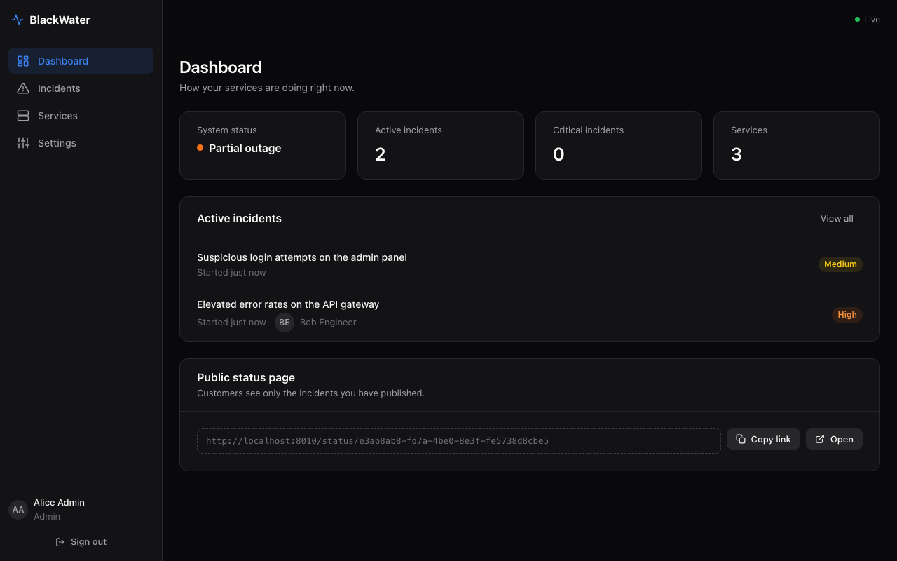
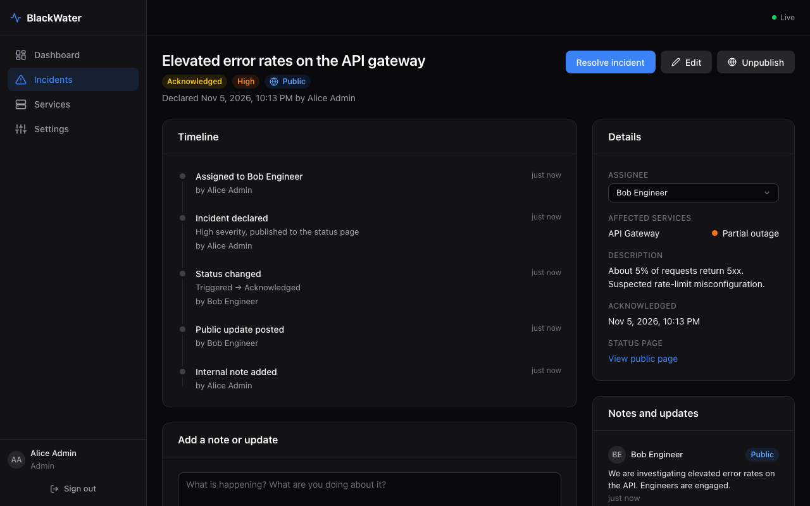
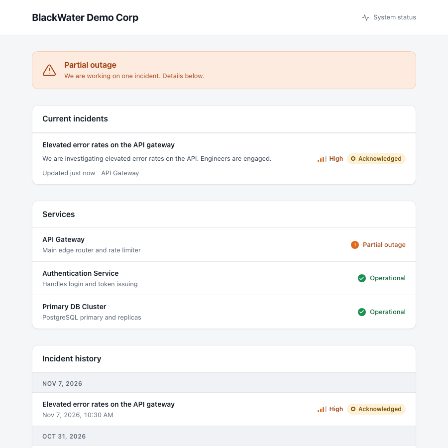
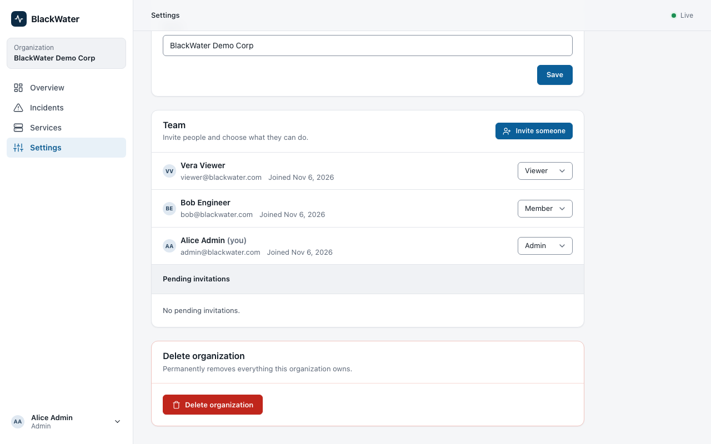

# BlackWater

Incident management with a public status page. A team lists the services it runs, declares an incident when one breaks, works it through a defined lifecycle with a full audit trail, and decides which incidents its customers get to see.



## What it does

- **Services and health.** Each service's health (operational, degraded, partial outage, major outage) is calculated from its open incidents, never entered by hand.
- **Incidents.** Declare, edit, assign, add internal notes or public updates, and move through `TRIGGERED → ACKNOWLEDGED → RESOLVED → CLOSED`. A resolved incident can be reopened; a closed one is final.
- **Audit timeline.** Every change to an incident is recorded with who made it and what changed.
- **Public status page.** Incidents are private until someone publishes them. Visitors see only published incidents and their public updates, and the health shown to them is calculated from published incidents only.
- **Teams.** An organization has administrators, members and viewers. Admins invite people with one-time links and change roles.
- **Live updates.** Open pages refresh over Socket.IO when something changes.

| Role | Can do |
|---|---|
| Viewer | Read everything in their organization |
| Member | Viewer, plus create and edit incidents and services, and publish incidents |
| Admin | Member, plus delete services, rename the organization, invite people and change roles |

Every organization's data is isolated from every other's.

| | |
|---|---|
|  |  |



## Stack

Node.js and Express, PostgreSQL through Prisma, Socket.IO, JWT and bcrypt, zod for validation. The interface is plain HTML, CSS and JavaScript served by the same Express app: no framework, no build step.

## How it works

One Node.js process serves the web pages, the JSON API under `/api` and a Socket.IO endpoint, backed by PostgreSQL.

- **A request** passes through rate limiting, JWT authentication (the user is reloaded from the database every time, so role changes and deleted accounts apply at once), a role check and a zod schema, then a thin controller hands it to a service. Services hold the business rules and all database access, and every query is filtered by the caller's organization.
- **Incident changes** lock the incident row, check the lifecycle table and write the audit entry in the same transaction, so concurrent changes are applied one at a time and a change can never exist without its record.
- **Live updates** are a doorbell: after a change commits, the server tells the organization's Socket.IO room "incident X changed", and each open page refetches through the normal API. A socket can only ever be in its own organization's room.
- **The public status page** reads through an allow-list of fields and only published incidents.

More in [docs/architecture.md](docs/architecture.md).

## Data model

`Organization` owns `User`s (each with a role), `Service`s, `Incident`s and `Invitation`s. An incident affects any number of services, has `IncidentUpdate`s (internal notes or public updates) and an append-only list of `TimelineEvent`s that records who changed what. Service health is not stored; it is calculated from open incidents when read. Details, constraints and migrations: [docs/database.md](docs/database.md).

## Quick start

You need Node.js 20.19 or newer (CI runs 20.19 and 22) and PostgreSQL (developed against 18, tested in CI on 16).

```bash
git clone https://github.com/Ayush-o1/BlackWater.git
cd BlackWater
npm install

createdb blackwater_dev
cp .env.example .env          # then edit DATABASE_URL and JWT_SECRET

npm run prisma:migrate:prod   # create the tables
npm run prisma:seed           # optional demo data
npm run dev                   # http://localhost:8000
```

Generate a secret with `node -e "console.log(require('crypto').randomBytes(32).toString('hex'))"`.

After seeding, sign in at <http://localhost:8000/login> with `admin@blackwater.com`, `bob@blackwater.com` (member) or `viewer@blackwater.com`, password `password123`. The seed prints the organization's public status page URL. It deletes all data, so it refuses to run when `NODE_ENV=production`.

Or create your own organization at `/register`.

## Configuration

Set in `.env` (see `.env.example`). Invalid or missing values stop the server at startup with a message.

| Variable | Default | |
|---|---|---|
| `DATABASE_URL` | required | PostgreSQL connection string |
| `JWT_SECRET` | required | At least 32 characters |
| `JWT_EXPIRES_IN` | `1d` | Token lifetime, e.g. `12h`, `7d` |
| `PORT` | `8000` | |
| `NODE_ENV` | `development` | `production` for deployments |
| `AUTH_RATE_LIMIT` | `20` | Registrations, invitation links and failed logins per IP per 15 min |
| `API_RATE_LIMIT` | `1000` | Requests per IP per 15 min for the rest of the API |
| `TRUST_PROXY` | `0` | Number of reverse proxies in front of the app |

## Scripts

| Command | |
|---|---|
| `npm run dev` | Start with automatic restart |
| `npm start` | Start |
| `npm test` | Apply migrations to the test database and run the backend tests |
| `npm run test:e2e` | Browser tests (Playwright) |
| `SMOKE_URL=https://... npm run smoke` | The main workflows against a running deployment (see [Deployment](docs/deployment.md#verification)) |
| `npm run lint` | ESLint |
| `npm run prisma:migrate` | Create and apply a migration during development |
| `npm run prisma:migrate:prod` | Apply pending migrations |
| `npm run prisma:seed` | Load demo data |
| `npm run prisma:studio` | Browse the database |

## Testing

```bash
createdb blackwater_test
cp .env.test.example .env.test   # point it at the disposable test database
npm test                         # unit and integration tests against real PostgreSQL
npx playwright install chromium
npm run test:e2e                 # browser tests against the real interface
```

The test database is emptied by every test, so never point `.env.test` at data you care about. CI also runs the browser tests in Firefox and WebKit, the backend tests on Node.js 20.19, and the smoke journey against the built Docker image. See [CONTRIBUTING.md](CONTRIBUTING.md).

## Deployment

The app is one long-running container plus PostgreSQL, so it needs a host that keeps a process alive and accepts WebSockets (Render, Railway, Fly.io, a VM). Serverless platforms such as Vercel do not fit. The repository includes a `Dockerfile` (applies migrations, then starts) and a Render Blueprint (`render.yaml`). Run exactly one instance. Setup, backups and troubleshooting: [docs/deployment.md](docs/deployment.md).

## Project layout

```
src/
  routes/        URL -> middleware -> controller
  controllers/   read the request, call a service, send the response
  services/      business rules and all database access
  middleware/    authentication, roles, validation, errors, rate limits
  validators/    zod schemas for every request
  socket/        Socket.IO server and event names
  utils/         health rule, errors, pagination, JWT, public-field whitelists
  database/      the Prisma client
  config/        environment validation
prisma/          schema, migrations, seed
public/          the web interface (HTML, CSS, ES modules)
tests/           unit and integration tests (Vitest, Supertest)
e2e/             browser tests (Playwright)
docs/            API, database, architecture, deployment
```

## Documentation

- [API reference](docs/api.md)
- [Architecture](docs/architecture.md)
- [Database and migrations](docs/database.md)
- [Deployment](docs/deployment.md): Render Blueprint and Dockerfile, backup and recovery, and why serverless hosting such as Vercel is not suitable
- [Security](SECURITY.md)
- [Contributing and testing](CONTRIBUTING.md)

## Limitations

- No password reset or email of any kind. Invitation links are copied and shared by hand.
- Tokens cannot be revoked before they expire (a deleted user's token stops working immediately, because the user is checked on every request).
- Users cannot be removed or deactivated, and belong to exactly one organization.
- Public status pages are addressed by the organization's id, not a custom name.
- One instance only: rate-limit counters and Socket.IO rooms live in process memory.

## License

MIT. See [LICENSE](LICENSE).
